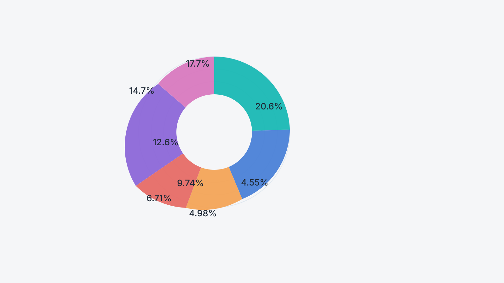
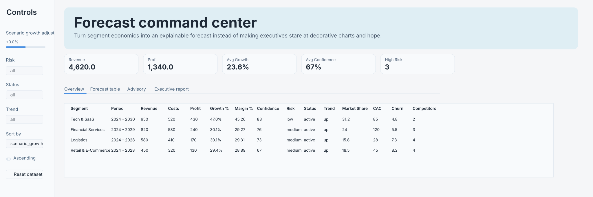
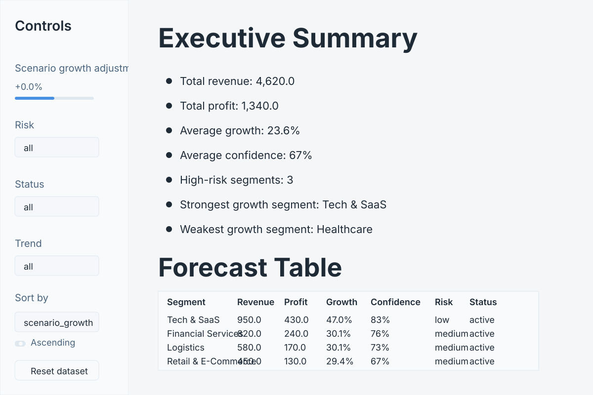
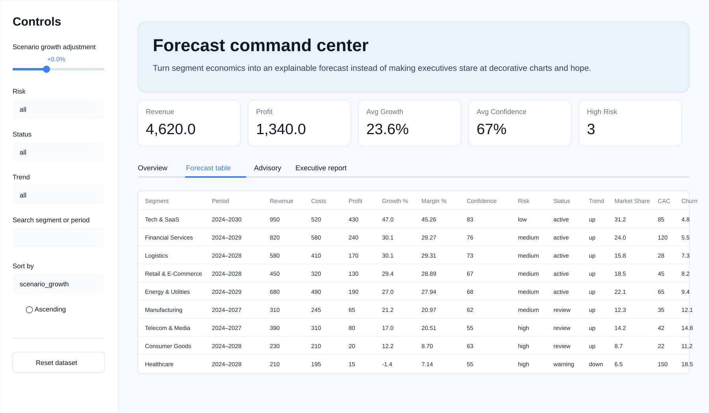

# Segment Forecasting Dashboard

[](https://github.com/cupidnavaz/segment-forecasting-dashboard/actions/workflows/ci.yml)
[](https://app.codecov.io/gh/cupidnavaz/segment-forecasting-dashboard)
[](https://pypi.org/project/segment-forecasting-dashboard)
[](LICENSE)
[](https://github.com/cupidnavaz/segment-forecasting-dashboard/issues)

A maintainable, testable Python implementation of a segments forecasting dashboard originally built as a single-file HTML/JS demo. This project preserves the canonical business rules while separating forecasting logic, data modeling, and presentation.

Table of contents
- [Highlights](#highlights)
- [Features](#features)
- [Badges](#badges)
- [Screenshots & demo](#screenshots--demo)
- [Requirements](#requirements)
- [Quick start](#quick-start)
- [Configuration](#configuration)
- [Usage examples](#usage-examples)
- [Reporting & exports](#reporting--exports)
- [Testing, linting & CI](#testing-linting--ci)
- [Packaging & releases](#packaging--releases)
- [Project structure](#project-structure)
- [Source lineage & data policy](#source-lineage--data-policy)
- [Design decisions](#design-decisions)
- [Contributing](#contributing)
- [Troubleshooting](#troubleshooting)
- [License](#license)
- [Support & contact](#support--contact)

Highlights
- Clean separation between business logic and presentation (Streamlit).
- Deterministic, test-covered forecasting and advisory engine.
- Exportable reports (CSV and Markdown) and developer-friendly packaging.

Features
- Segment-level metrics: revenue, cost, profit, margin, growth, confidence, risk, trend.
- Scenario growth adjustments and multi-year trajectory analysis.
- Multi-criteria filtering: risk, status, trend, and text search.
- Stable sorting on computed metrics and comparative views (revenue, profit).
- Visualizations: revenue mix, risk distribution, segment health radar.
- Explainable advisory scoring with human-readable rationales.
- CSV export and executive Markdown report generation.
- Automated tests (pytest), linting (ruff), and packaging via pyproject.toml.

Badges
- CI: primary pipeline (ci.yml) shows overall repository health.
- Codecov: coverage reporting.
- PyPI: published package status (if released).
- License and Issues: project metadata.

## Screenshots & demo

The gallery below follows the supplied dashboard captures. Each view is shown at full content width so charts, table labels, and controls remain legible instead of being squeezed into small side-by-side thumbnails.

### Dashboard overview



### Growth and risk analysis



### Segment health radar



### Forecast table



Requirements
- Python 3.11+ (project metadata may indicate Python 3.13 compatibility when dependency wheels are available).
- pip
- Browser for Streamlit UI

Quick start

Clone, create a virtual environment, install dependencies, and run the UI.

Replace <repository-url> with your repository remote when cloning.

macOS / Linux
```bash
git clone <repository-url>
cd segment-forecasting-dashboard

python3 -m venv .venv
source .venv/bin/activate

python -m pip install --upgrade pip
python -m pip install -e ".[dev]"
```

Windows PowerShell
```powershell
git clone <repository-url>
cd segment-forecasting-dashboard

py -m venv .venv
.venv\Scripts\Activate.ps1

python -m pip install --upgrade pip
python -m pip install -e ".[dev]"
```

Usage examples

Run the Streamlit UI
```bash
streamlit run app.py
```

Or, after editable installation (console entry point)
```bash
segment-dashboard
```

Export a CSV report (example CLI)
```bash
segment-dashboard export --format csv --output reports/segments.csv
```

Generate executive Markdown report
```bash
segment-dashboard report --output reports/executive.md
```

Configuration

Environment variables and config file
- The app supports lightweight configuration via environment variables and a config file under .streamlit/config.toml and/or docs/config.example.toml.
- Example env vars:
  - SFD_LOG_LEVEL=INFO
  - SFD_DATA_PATH=./data/segments.csv
  - SFD_TICKER_FIXTURE=true

Data sources
- The repository includes the canonical nine-segment dataset in src/segment_forecasting_dashboard/data.py.
- The included market ticker is a static fixture. To use live market data, integrate a verified market-data provider and implement a secure connector (see docs/operations.md).

Reporting & exports
- Reports are generated from the same forecast DataFrame used by the UI to ensure parity between interactive views and exports.
- Supported export formats:
  - CSV: per-segment exports and aggregated summaries.
  - Markdown: executive report with charts embedded as images (SVG/PNG).
- Example: use the CLI or the UI to generate exports; configure output directory in the command or app settings.

Testing, linting & CI
- Run unit tests
```bash
pytest
```
- Linting
```bash
ruff check .
```
- Recommended CI workflows:
  - Run ruff on push and pull requests.
  - Run pytest with coverage and upload coverage to Codecov.
  - Build package on release tags.

Packaging & releases
- Packaging uses PEP 621 metadata in pyproject.toml.
- Build a wheel and sdist
```bash
python -m pip install --upgrade build
python -m build
```
- Optionally publish to PyPI with twine:
```bash
python -m pip install --upgrade twine
python -m twine upload dist/*
```

Project structure
```
segment-forecasting-dashboard/
├── app.py
├── pyproject.toml
├── requirements.txt
├── requirements-dev.txt
├── README.md
├── CHANGELOG.md
├── CONTRIBUTING.md
├── SECURITY.md
├── LICENSE
├── .gitignore
├── .streamlit/
│   └── config.toml
├── docs/
│   ├── architecture.md
│   ├── data-model.md
│   ├── forecasting-methodology.md
│   ├── operations.md
│   └── release-checklist.md
├── docs/images/
│   ├── mockup-dashboard-overview.svg
│   ├── mockup-segment-card.svg
│   ├── mockup-mobile-header.svg
│   └── mockup-multi-monitor-hero.svg
├── src/
│   └── segment_forecasting_dashboard/
│       ├── __init__.py
│       ├── analytics.py
│       ├── charts.py
│       ├── cli.py
│       ├── data.py
│       ├── forecasting.py
│       └── reporting.py
└── tests/
    ├── test_analytics.py
    ├── test_forecasting.py
    └── test_reporting.py
```

Source lineage & data policy
- This repository is a Python port of an earlier single-file HTML/JS demo. The original calculation rules and canonical dataset are preserved for compatibility and reproducibility.
- Market ticker included is a static fixture for illustrative purposes and must not be presented as real-time financial data. Integrate a verified market provider to present live market data and replace the fixture with a real API-backed connector.

Design decisions
1. Business logic is independent of the Streamlit UI to maximize reusability and make formulas testable via unit tests.
2. Canonical dataset is explicit and maintained in `data.py` for clarity and reproducibility.
3. Reports are produced from the same forecast DataFrame used by the UI to avoid divergence.
4. Static fixtures are clearly labeled; the application does not ship fake live data.
5. Tests target observable behavior rather than implementation details to allow safe refactors.
6. Packaging uses PEP 621 (pyproject.toml) and provides an editable install for developer convenience.

Contributing
- Please see CONTRIBUTING.md for full guidelines.
- Quick checklist for contributors:
  - Fork the repo and create feature branches.
  - Run ruff and pytest locally before submitting PRs.
  - Use conventional commit messages and reference issues when relevant.
  - Add unit tests for significant changes and keep the public API stable.
  - Provide example images or GIFs for UI changes (place under docs/images/).

How to add screenshots / GIFs
1. Capture screenshots at 1280×720 or 1600×900 for clarity.
2. Optimize PNG/JPEG images and keep GIFs short; consider MP4 for larger walkthroughs and link to them from the README.
3. Add files under docs/images/, commit them, and reference them in the README:
```markdown


```

Troubleshooting
- Common issues:
  - Streamlit permission errors: ensure virtual environment is active and packages are installed.
  - Broken image links in README: commit images to docs/images/ and push to the default branch.
  - Test failures: run pytest -q to see failing tests and run individual tests with -k.
- Still stuck? Open an issue with reproduction steps, environment, and logs.

License
- MIT. See `LICENSE` for full terms.

Support & contact
- Open an issue for bugs, feature requests, or questions.
- For operational questions, see docs/operations.md or open a discussion on the repository.
