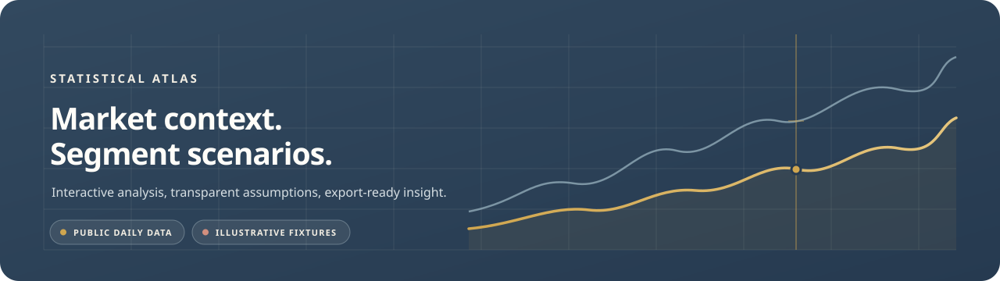
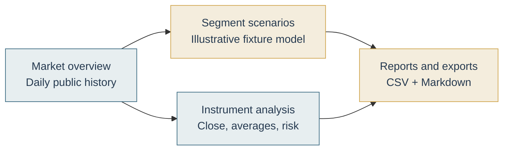

<p align="center">
  
</p>

<h1 align="center">Segment Forecasting Dashboard</h1>

<p align="center">
  An interactive market-intelligence workspace for daily context, transparent segment scenarios,
  and executive-ready exports.
</p>

<p align="center">
  <a href="https://github.com/cupidnavaz/segment-forecasting-dashboard/actions/workflows/ci.yml">
    
  </a>
  
  
  
  <a href="LICENSE"></a>
</p>

<p align="center">
  <a href="#quick-start">Launch locally</a> ·
  <a href="#product-tour">Explore features</a> ·
  <a href="#data-and-methodology">Review methodology</a> ·
  <a href="#quality-checks">Quality checks</a>
</p>



The dashboard combines **public daily market history** with transparent descriptive indicators and a separate **illustrative segment dataset**. Interactive controls recalculate the visible analysis and bounded scenario overlay; the underlying fixture fundamentals remain unchanged. The application is built with Streamlit, pandas, and Plotly.

> **Scope and data boundary:** Market observations can be delayed, incomplete, or unavailable and are not guaranteed real-time. Segment economics are static demo fixtures—not company financial statements. Market-proxy assignments are illustrative assumptions, not measured relationships, predictions, or investment advice.

## Explore this guide

- [Product tour](#product-tour)
- [Interactive controls](#interactive-controls)
- [Charts, tables, and indicators](#charts-tables-and-indicators)
- [Data and methodology](#data-and-methodology)
- [Visual system and interaction design](#visual-system-and-interaction-design)
- [Exports and reports](#exports-and-reports)
- [Quick start](#quick-start)
- [Project map](#project-map)
- [Quality checks](#quality-checks)
- [Limitations and responsible use](#limitations-and-responsible-use)

## Product tour

| Workspace | What you can do |
|---|---|
| **Market overview** | Scan selected instruments, compare indexed price history, inspect historical risk, read the latest indicator table, and export observations. |
| **Instrument analysis** | Focus on one instrument, toggle its 20- and 50-observation averages, review close/change/average/drawdown KPIs, and download its history. |
| **Segment scenarios** | Adjust scenario assumptions, filter and sort segment fixtures, compare analytical charts, review the forecast table, and inspect explainable advisory signals. |
| **Reports and exports** | Preview a combined executive report and download it with the current market snapshot and segment filters. |



<details>
<summary><strong>Market overview — pulse cards, history, and risk</strong></summary>

- **Market pulse cards** show the latest available close and prior-observation change for up to four selected instruments.
- **Indexed comparison** rebases each selected series to 100 at its first observation so different price scales can be compared.
- **Price and averages** focuses the chart on one instrument and can overlay descriptive 20- and 50-observation simple moving averages.
- **Historical risk profile** compares annualized historical volatility with drawdown from the high in the selected window.
- **Latest indicator readings** provide a compact table of close, daily change, rolling averages, volatility, and drawdown.
- **Descriptive observations** explain the indicator readings in neutral language; they are not trade instructions.

</details>

<details>
<summary><strong>Instrument analysis — focused inspection</strong></summary>

Choose any selected instrument with usable observations. Four KPI cards summarize the latest close, daily change, 20-observation average, and window drawdown. The interactive history chart can show or hide rolling averages; the observation table and CSV download retain the full derived history for that instrument.

</details>

<details>
<summary><strong>Segment scenarios — controls, KPIs, and analytical views</strong></summary>

The scenario workspace starts with a clear illustrative-data notice. Its KPI cards summarize filtered fixture revenue, fixture profit, adjusted scenario growth, fixture confidence, and the number of high-risk fixtures.

The **Overview** tab contains:

1. A grouped **revenue and profit bar chart** by segment.
2. A **revenue-mix doughnut chart**.
3. A **market-adjusted growth trajectory** with interactive segment traces.
4. A **risk-distribution bar chart** for low, medium, and high fixture classifications.
5. A **segment-health radar chart** comparing up to five leading filtered segments.

The **Forecast table** exposes proxy mapping, proxy return and adjustment, fixture revenue/cost/profit, adjusted growth, margin, confidence, and other segment inputs. The **Advisory** tab shows rule-based health scores, impacts, gaps, and priority-action counts.

</details>

<details>
<summary><strong>Reports — reproducible snapshots</strong></summary>

The report view combines the filtered segment summary with source-attributed latest market context. Download a Markdown executive report or the filtered market-linked segment forecast CSV. Exports follow the current widget values; report copy preserves the illustrative-data and source limitations.

</details>

## Interactive controls

Controls live in the sidebar and update the applicable charts, metrics, tables, and exports.

| Control | Effect |
|---|---|
| **Workspace** | Switch between Market overview, Instrument analysis, Segment scenarios, and Reports. |
| **Instruments** | Select from S&P 500, NASDAQ Composite, Dow Jones Industrial Average, crude oil futures, gold futures, Bitcoin, and Ethereum. |
| **History window** | Choose 1 month, 3 months, 6 months, 1 year, or 2 years of daily observations. |
| **Auto-refresh** | Re-fetch and recalculate while the Streamlit browser session remains active. |
| **Refresh interval** | Set the session refresh cadence to 1, 5, 15, or 30 minutes. |
| **Refresh data** | Request a fresh snapshot immediately. |
| **Chart view** | Switch between indexed comparison and one instrument’s close/average view. |
| **Scenario adjustment** | Add a user-selected growth adjustment in percentage points. |
| **Proxy sensitivity, lookback, and cap** | Tune the illustrative market-linked scenario overlay. |
| **Risk, status, trend, and search** | Filter rows by classification, fixture status, growth trend, segment, or period. |
| **Sort and direction** | Reorder filtered scenario rows by growth, revenue, profit, confidence, margin, or churn. |
| **Reset segment fixtures** | Restore the built-in illustrative dataset for the current browser session. |
| **Animate chart transitions** | Enable/disable Plotly transitions; reduced-motion preferences are respected in the stylesheet. |

### Market data automation

The app fetches daily history from the Yahoo Finance chart endpoint for the selected watchlist instruments. A Streamlit fragment refreshes the market view and derived scenarios at the chosen cadence while the browser session is active. Results are briefly cached; a manual refresh is also available.

Failures are surfaced: unavailable symbols are identified when other symbols load; if the full selection fails, the dashboard shows a recoverable provider message. This is **session-driven refresh**, not a background scheduler or a guaranteed real-time feed.

## Charts, tables, and indicators

Charts are built with Plotly and support hover inspection, legends, zoom, and pan where applicable. Shared chart styling uses a synchronized crosshair, consistent axes, and restrained transition motion.

| Visualization | Data represented |
|---|---|
| Indexed market comparison | Relative close movement from a common starting value of 100. |
| Instrument history | Daily close and optional 20-/50-observation averages. |
| Market risk profile | Latest 20-observation annualized volatility and selected-window drawdown. |
| Revenue and profit bars | Illustrative fixture revenue and profit by segment. |
| Revenue-mix doughnut | Each visible segment’s share of filtered fixture revenue. |
| Growth trajectory | Scenario-adjusted fixture growth applied as an illustrative trajectory. |
| Risk distribution | Counts of visible low-, medium-, and high-risk fixtures. |
| Health radar | Bounded comparisons of fixture margin, market share, confidence, churn, and competition. |

Market indicators include daily percentage return, 20-/50-observation simple moving averages, 20-observation annualized historical volatility, and drawdown from the selected-window high. With insufficient observations, values remain unavailable rather than being invented.

## Data and methodology

### Bounded market-linked scenario

The market overlay adjusts **scenario growth only**:

```text
market_adjustment_pp =
    clip(proxy_return_over_lookback * sensitivity, -maximum_adjustment, +maximum_adjustment)

scenario_growth =
    base_growth + user_scenario + market_adjustment_pp
```

Proxy mappings are illustrative and configurable in the application code; they are not empirically estimated sector betas. Missing proxy history produces no proxy adjustment. Market movement does not change fixture revenue, costs, profit margin, churn, confidence, market share, or competition.

### Forecast calculations

The deterministic engine calculates:

```text
profit       = revenue - costs
profit_margin = profit / revenue * 100
growth       = profit_margin * 0.8
             + market_share * 0.3
             + units_sold / 15
             - churn * 0.6
confidence   = clamp(round(60 + revenue / 40 + units_sold / 10 - churn * 1.5), 55, 98)
```

Growth is rounded to one decimal place. Risk uses explicit fixture overrides when present; otherwise it follows the documented margin, churn, and competition thresholds. Trend is derived from growth. See [Forecasting Methodology](docs/forecasting-methodology.md) and [Data Model](docs/data-model.md) for field definitions and rules.

## Visual system and interaction design

The interface uses the **Statistical Atlas** visual language: warm chart-stock surfaces, disciplined ink-blue navigation, precise chart annotation, and a restrained editorial type pairing.

| Token | Color | Use |
|---|---|---|
| Atlas ink | `#263A50` | Navigation, primary titles, chart labels. |
| Chart paper | `#F3EEE3` | Main canvas and light surfaces. |
| Panel | `#FBF8F1` | KPI and chart containers. |
| Terracotta | `#9A4939` | Selected states, risk emphasis, chart series. |
| Atlas blue | `#3D6C83` | Data series and informative states. |
| Field green | `#5F7656` | Positive/low-risk states. |
| Brass | `#D0A64F` | Focus ring, chart marker, restrained highlight. |

The custom atlas mark pairs a rising line with a crosshair point. Status badges distinguish daily-data readiness, partial/unavailable feeds, descriptive history, and illustrative scenarios. Responsive Streamlit layouts, visible keyboard focus, chart labels, and reduced-motion handling support comfortable scanning across screen sizes.

## Exports and reports

- **Market history CSV** — selected instruments and raw observations.
- **Instrument history CSV** — one selected symbol’s derived history.
- **Filtered forecast CSV** — current market-linked scenario rows and active filters.
- **Combined executive Markdown report** — filtered segment summary plus source-attributed market snapshot.

## Quick start

### Requirements

- Python 3.11 or newer
- Internet access for the Yahoo Finance chart endpoint

### Windows PowerShell

```powershell
git clone https://github.com/cupidnavaz/segment-forecasting-dashboard.git
Set-Location segment-forecasting-dashboard
python -m venv .venv
.\.venv\Scripts\Activate.ps1
python -m pip install --upgrade pip
python -m pip install -e ".[dev]"
streamlit run app.py
```

If PowerShell blocks activation:

```powershell
.\.venv\Scripts\python.exe -m pip install -e ".[dev]"
.\.venv\Scripts\python.exe -m streamlit run app.py
```

### macOS / Linux

```bash
git clone https://github.com/cupidnavaz/segment-forecasting-dashboard.git
cd segment-forecasting-dashboard
python3 -m venv .venv
source .venv/bin/activate
python -m pip install --upgrade pip
python -m pip install -e ".[dev]"
streamlit run app.py
```

Open the local URL printed by Streamlit. The installed console command `segment-dashboard` starts the same application.

## Project map

```text
.
├── .github/workflows/ci.yml          # automated tests on pushes and pull requests
├── app.py                            # Streamlit layout, controls, state, and refresh
├── styles.css                        # responsive Statistical Atlas interface
├── docs/
│   ├── images/                       # atlas mark and README visual
│   ├── architecture.md
│   ├── data-model.md
│   ├── forecasting-methodology.md
│   ├── live-market-linked-forecast.md
│   ├── operations.md
│   └── release-checklist.md
├── original-source/                  # retained source-lineage reference
├── src/segment_forecasting_dashboard/
│   ├── analytics.py                  # explainable fixture advisory signals
│   ├── charts.py                     # reusable Plotly figure builders
│   ├── cli.py                        # installed dashboard launcher
│   ├── data.py                       # canonical illustrative fixtures/watchlist
│   ├── forecasting.py                # formulas, filters, and executive summary
│   ├── market_analysis.py            # descriptive historical indicators
│   ├── market_data.py                # public history and snapshot helpers
│   ├── market_forecasting.py         # bounded proxy-linked scenario calculation
│   └── reporting.py                  # CSV and Markdown exports
└── tests/                            # data, analytics, charts, forecasts, reports
```

## Quality checks

Install the development dependencies and run the suite locally:

```bash
python -m pip install -e ".[dev]"
python -m pytest -q
ruff check app.py
```

GitHub Actions runs the automated test suite on Python 3.11, 3.12, and 3.13 for pushes and pull requests. Tests cover market-response parsing and snapshots, descriptive indicators, forecast and proxy calculations, charts, advisory rules, and report/export behavior.

## Limitations and responsible use

This project provides general educational market context and descriptive analytics. It does **not** provide personalized financial, investment, tax, or legal advice, and does not recommend buying, selling, or holding securities.

Market history may be delayed, incomplete, unavailable, or incorrect. Historical returns, averages, volatility, and drawdowns are descriptive—not predictions. Segment economics are static demo fixtures, not verified company financial statements. Market proxies and scenario adjustments do not establish causality or forecast company performance. Past performance does not guarantee future results.

For production or commercial use, select a properly licensed market-data provider and comply with its terms. See [SECURITY.md](SECURITY.md) for vulnerability reporting and [LICENSE](LICENSE) for license terms.
